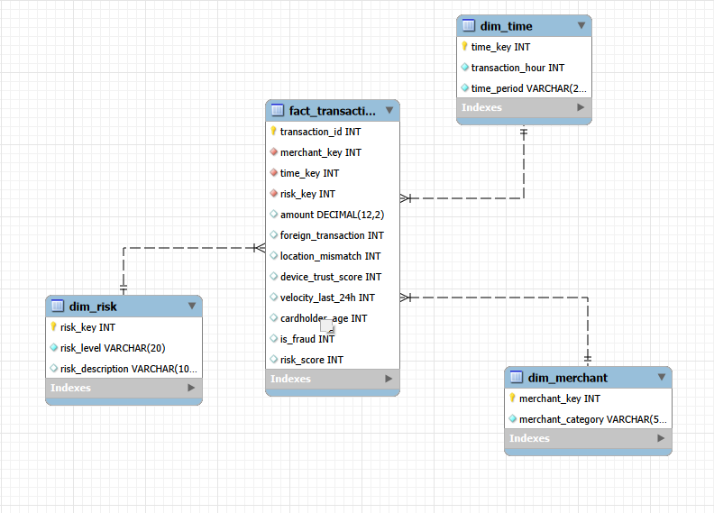
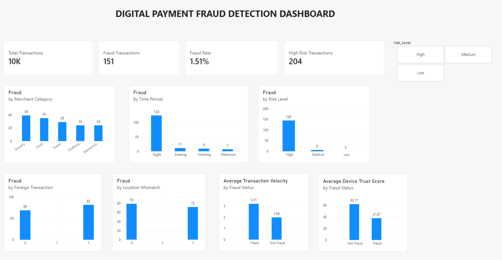

# 💳 Digital Payment Fraud Detection Data Warehouse

An end-to-end ETL and Data Warehousing project for analyzing digital payment transactions and identifying potential fraud patterns using Python, MySQL, SQL, and Power BI.

## 📌 Overview

This project implements a Data Warehouse to organize, transform, and analyze digital payment transaction data.

A Python-based ETL pipeline extracts transaction data, performs data cleaning and transformation, generates risk scores and risk levels, and loads the processed data into a MySQL Data Warehouse.

SQL queries are used to analyze fraud patterns, while Power BI provides an interactive dashboard for visualizing important insights.

## 🛠️ Technologies Used

| Technology | Purpose |
|---|---|
| Python | ETL processing |
| Pandas | Data cleaning and transformation |
| MySQL | Data Warehouse |
| SQL | Fraud analysis and queries |
| Power BI | Interactive dashboard |
| Microsoft Excel | Dataset |

## 🏗️ System Architecture

```text
       Transaction Dataset
                |
                v
             EXTRACT
                |
                v
       TRANSFORM & CLEAN
                |
                v
              LOAD
                |
                v
       MySQL Data Warehouse
                |
                v
           SQL Analysis
                |
                v
        Power BI Dashboard
```

## 🔄 ETL Process

**1. Extract**
- Load transaction data from the Excel dataset.
- Read transaction attributes using Python and Pandas.

**2. Transform**
- Check and clean the dataset.
- Process transaction attributes.
- Generate time periods.
- Calculate risk scores and classify transactions into risk levels.

**3. Load**
- Load the processed data into the MySQL Data Warehouse.
- Organize the data using a Star Schema.

## ⭐ Data Warehouse Design – Star Schema

The Data Warehouse follows a Star Schema consisting of one fact table and three dimension tables.

**Fact Table**
- `fact_transaction`

**Dimension Tables**
- `dim_merchant`
- `dim_time`
- `dim_risk`

The fact table stores transaction details and connects to the dimension tables through foreign keys.



## 📊 Power BI Dashboard

An interactive Power BI dashboard is developed to analyze transaction fraud patterns.

### Dashboard KPIs
- Total Transactions
- Fraud Transactions
- Fraud Rate
- High Risk Transactions

### Visualizations
- Fraud by Merchant Category
- Fraud by Time Period
- Fraud by Risk Level
- Fraud by Foreign Transaction
- Fraud by Location Mismatch
- Average Transaction Velocity by Fraud Status
- Average Device Trust Score by Fraud Status

### Dashboard Preview



## 📈 Dataset Overview

| Metric | Value |
|---|---:|
| Total Transactions | 10,000 |
| Fraudulent Transactions | 151 |
| Non-Fraudulent Transactions | 9,849 |
| Fraud Rate | 1.51% |
| Original Attributes | 10 |

## 🔍 Key Analytical Findings

- Overall transaction fraud rate is **1.51%**.
- Night transactions have a higher fraud rate than other time periods.
- Foreign transactions show an **8.38%** fraud rate.
- Transactions with location mismatch show an **8.40%** fraud rate.
- High-risk transactions have a **71.08%** fraud rate.
- Fraudulent transactions have a lower average device trust score than non-fraudulent transactions.

## 📁 Repository Structure

```text
Digital-Payment-Fraud-Detection-Data-Warehouse/
│
├── Digital_Payment_Fraud_DW/
│   ├── dashboard/
│   │   └── Power BI Dashboard
│   │
│   ├── data/
│   │   └── Transaction Dataset
│   │
│   ├── etl/
│   │   └── etl.py
│   │
│   ├── output/
│   │   └── cleaned_fraud_data.csv
│   │
│   ├── sql/
│   │   └── fraud_analysis_queries.sql
│   │
│   └── screenshots/
│       ├── powerbi_dashboard.png
│       └── star_schema.png
│
└── README.md
```

## 🚀 Project Outcomes

- Implemented a Python-based ETL pipeline.
- Designed and implemented a MySQL Star Schema.
- Performed SQL-based transaction fraud analysis.
- Developed an interactive Power BI dashboard.
- Identified important fraud patterns and risk indicators.

## ⚠️ Disclaimer

This project is developed for educational and analytical purposes. It focuses on data warehousing, transaction analysis, and risk classification. It is not a production-ready fraud detection system.
